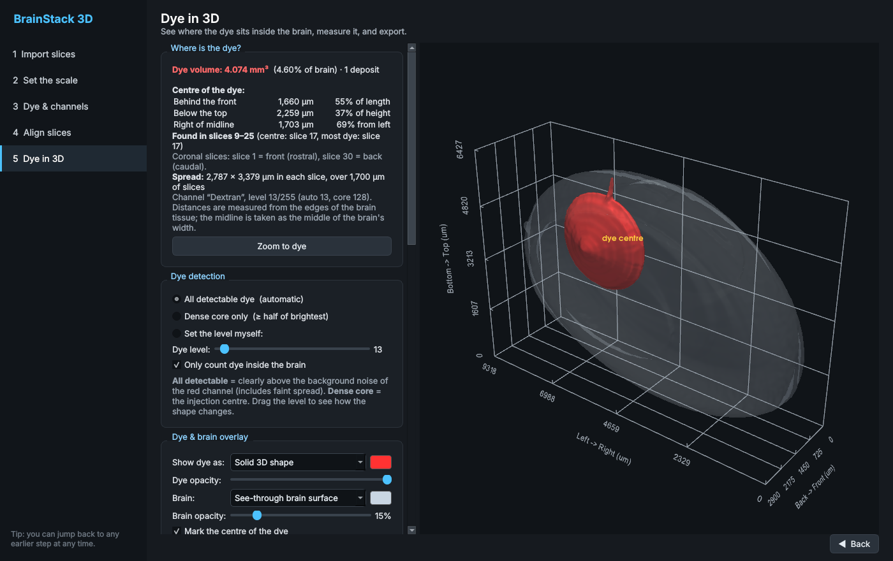

# BrainStack 3D

Find out **where red dextran dye sits in the brain, in 3D**. Load your serial fluorescence
slice images and BrainStack 3D aligns them and finds the dye. It shows the dye as a solid
red shape inside a **see-through overlay of the brain** you can rotate, and reports where it
is and how much there is, in real micrometres.



## Use it in your browser (no install)

The `docs/` folder is a complete browser version of the same five steps. Host it free on
GitHub Pages (see **[PUBLISHING.md](PUBLISHING.md)**), then anyone can open the link and drop
in their slices. All processing happens on their own computer; no images are uploaded.

To try it locally: `cd docs && python3 -m http.server 8000`, then open http://localhost:8000.

## Quick start (desktop app)

1. Install **Python 3.10 or newer** from https://www.python.org/downloads/
   (on Windows, tick "Add Python to PATH" during install).
2. Start the app:
   - **Windows:** double-click `run_windows.bat`
   - **Mac / Linux:** run `bash run_mac_linux.sh` in a terminal

   The first launch installs the libraries it needs (a few minutes). After that it starts
   straight away.
3. **No data yet?** Make a synthetic test brain (30 slices, 3 channels; channel 3 is a red
   dextran injection with a needle track):
   ```
   .venv/bin/python tools/make_demo_data.py demo_slices        # Mac/Linux
   .venv\Scripts\python tools\make_demo_data.py demo_slices    # Windows
   ```
   For the demo, the slice spacing is **100 µm** and the tissue is **6,000 µm** tall.

Manual install: `pip install -r requirements.txt` and then `python main.py`.

## The five steps

| Step | What you do |
|---|---|
| **1. Import slices** | Add images or a folder (TIFF incl. multi-channel and 16-bit, PNG, JPG). Answer **how the slices were cut**: coronal, sagittal or transverse (see below). The slices are put in anatomical order, with each end labelled. Choose a working resolution. |
| **2. Set the scale** | Enter the slice spacing (Z) and choose how to get the pixel size (X/Y). See below. |
| **3. Dye & channels** | Pick the channel that holds the **red dextran** (it is guessed automatically). Every other channel counts as "brain": the brain outline and the alignment come from those, so the dye never distorts them. Clean up background and noise. |
| **4. Align slices** | Auto-align on the brain channels (shift and rotation, including upside-down slices). Then scrub through the magenta/green overlay and fix any slice by hand, including mirrored slices. **Straighten the whole stack** turns everything so the brain sits upright. |
| **5. Dye in 3D** | The dye inside a see-through brain, plus a full location report. Other views are still available: stacked images, point cloud, solid volume, and brain surface. |

## Cutting plane and orientation (step 1)

Step 1 asks how the slices were cut. A small diagram shows where the cuts go.

| Plane | What the cuts look like | Slice 1 → last slice |
|---|---|---|
| **Coronal** | Front-to-back, like slicing bread from the nose to the cerebellum | front (rostral) → back (caudal) |
| **Sagittal** | Side-to-side, parallel to the midline | left → right |
| **Transverse / horizontal** | Top-to-bottom, parallel to the table | top (dorsal) → bottom (ventral) |

**Putting the slices in order**
- *My files are numbered* says which way your file numbers run, e.g. "back → front".
- If your files run the other way, the list is reversed, so slice 1 is always the standard
  start shown above.
- The first and last rows of the list are labelled with their anatomical end.
- If you change this after the model is built, the slices are flipped in place. Nothing is
  reloaded or re-aligned.

**Which way the images face.** Two quick questions, depending on the plane:
- Is the top of each image the top of the brain?
- Which way does the nose point (sagittal/transverse)?
- Is the right side of each image the animal's right (coronal/transverse)? "Not sure" is
  allowed; the report then says *side A/B* instead of left/right.

**What your answers change**
- **The 3D model sits upright** with its nose forward. The axes are labelled
  *Left → Right*, *Back → Front* and *Bottom → Top*.
- **Camera buttons**:
  - *Front*: facing the animal, so its right side is on your left.
  - *Top*: looking down from above.
  - *Side*: from the animal's left.
  - *3D angle*: front-left, from above.
- **The dye report is in anatomical terms**: µm *behind the front*, *below the top*, and
  *left/right of the midline*, each also as a % of the brain.
- **Step 2's tissue-size option** offers the dimensions you can actually see in that plane.
  Transverse slices show width and length, but not height.

If the reference slice was mounted at an angle, the whole aligned stack inherits that tilt.
Use **Straighten the whole stack** in step 4 (90° and 5° steps) to make it upright.

## Seeing and measuring the dye (step 5)

**The 3D view**
- **Dye** can be shown as:
  - a **solid 3D shape**;
  - a **glow**, where brighter means more dye, so you can see the concentrated core
    inside the fainter spread;
  - or both.
- **Brain overlay** can be:
  - a **see-through brain surface** (the default);
  - a **haze** of the brain's own fluorescence;
  - **faint slice images**;
  - or hidden.
- The **Brain opacity** slider sets how see-through the brain is. You can change the colour
  of both the dye and the brain.
- The brain and dye come from the same aligned slices, so they always line up exactly.
- A yellow marker shows the **dye centre**. **Zoom to dye** flies the camera to it, and the
  **cut-away plane** slices the brain open.

**Dye detection** has three settings:
- **All detectable dye** (default): anything clearly above the red channel's own background
  noise, about 8× the noise spread. This includes faint spread and needle tracks.
- **Dense core only**: at least half as bright as the brightest dye. Use this for the
  injection centre.
- **Set the level myself**: drag a slider and watch the 3D shape update.

**"Where is the dye?" report**
- Dye volume (mm³) and % of brain volume.
- Number of separate deposits.
- Centre of the dye in µm **behind the front**, **below the top**, and **left/right of the
  midline**. Each is also given as a % of the brain's length, height or width.
- Which slices contain dye, plus the centre slice and the brightest slice.
- How far the dye spreads in X, Y and Z.

Distances are measured from the edges of the brain tissue, and the midline is taken as the
middle of the brain's width. Left/right are only as reliable as your answer in step 1.

**Exports**
- **Dye report (CSV)**: everything above, plus per-deposit and per-slice dye areas.
- **Dye 3D shape (STL)**, in the same micrometre coordinates as **Brain surface (STL)**.
  Load both into Blender or another 3D tool and they line up.
- **Picture (PNG)**.
- The aligned 3D stack as a **TIFF** for Fiji.

## How the scaling works

Every voxel (3D pixel) in the model is **X µm wide × X µm tall × Z µm deep**:

- **Z** is the slice spacing you enter, centre to centre. If you cut 10 µm sections but only
  imaged every 4th one, enter 40 µm.
- **X/Y** is the microns per pixel. The formula is
  `pixel size = real distance ÷ number of pixels`.
  For example, if the tissue is 6,000 µm tall and spans 1,200 pixels, each pixel is 5 µm.

### Three ways to set X/Y, best first

1. **Microscope value.** Use this when you know µm per pixel for your objective and camera.
   The app also reads it from Fiji/ImageJ and OME-TIFF files automatically. With the same
   microscope settings, every brain gets exactly the same scale.
2. **Scale bar.** Click both ends of a scale bar in an image and type its length.
3. **Tissue size.** Use this when you only know roughly how big the tissue is (for example,
   6,000 µm tall). To keep sizing consistent:
   - The app finds the slice with the largest tissue and sets that to your real size.
   - That **one** pixel size is then applied to every slice, so smaller slices (front and back
     of the brain) correctly come out smaller.
   - The measurement uses a rotation-proof caliper width, so slices mounted at an angle don't
     inflate it.
   - All images are downscaled by the **same** factor, so a pixel means the same distance in
     every slice.

   Brains differ in size, so this is an estimate. Use option 1 or 2 for publishable
   measurements.

## Measurements and exports

- **Tissue size** (width × height × depth) and **tissue volume** in mm³. Volume uses the
  Cavalieri method: the sum of slice areas × slice spacing.
- **Signal per channel:** the volume and % of tissue brighter than a threshold you set.
- **Distances:** right-click two points in the 3D view.
- **Exports:**
  - Measurements as CSV, including per-slice areas.
  - Aligned 3D stack as TIFF. It opens in Fiji/ImageJ with the correct scale.
  - Surface mesh as STL/OBJ/PLY, for 3D printing, Blender or other tools.
  - Picture as PNG.

## Dye-only images (no DAPI or other brain stain)

If every image shows only the red dye, the software adapts automatically:

- **Blank channels are ignored.** Photos saved as RGB, whose green and blue are empty, are
  treated as a single "Red" channel.
- **Images with no red signal are flagged.** Step 1 offers to leave out images like a lone
  DAPI picture.
- **The brain outline comes from the tissue's own faint red glow.**
- **Step 4 aligns on the tissue outline plus signal.** Bright dye spots change from slice to
  slice, so matching on them alone fails. Two options are on by default:
  - **All slices are upright**: only small turns are tried.
  - **Check for mirrored slices**: catches sections mounted face-down, for example sagittal
    slices with the nose pointing the other way.

  Untick *upright* if some sections are upside down.
- **Dye detection uses each slice's own background.** One brightly imaged slice can't hide
  the dye in the others. The level is 4× the tissue's noise spread above its typical glow.


- **Keep "Same scale for whole stack"** in step 3 (the default) when measuring dye. Otherwise
  each slice's dye brightness is rescaled on its own.
- **Bleed-through.** If the red dye also shows up faintly in another channel, or that
  channel bleeds into red, the automatic level may pick up a haze. Switch to **Dense core**
  or set the level yourself.

- **Alignment channel.** In step 4, align on a channel that stains everything, such as DAPI,
  Hoechst or NeuroTrace. Sparse labels like a single injection site are poor references.
- **Slices that most often need a manual fix:**
  - The **first and last slices**: they are small and have few features.
  - **Torn or folded sections.**
  - **Mirrored slices**: tick *Mirror*, then *Re-align just this slice*.
- **Missing or damaged sections.** Leave a gap in your numbering and adjust Z, or remove the
  section. The app assumes even spacing between the images you give it.
- **Memory.** Start at *Balanced (1024 px)*. The import step shows an estimate of how much
  memory you'll need.

## Project layout

```
main.py                     start the app
brainstack/io.py            load images at one consistent scale
brainstack/calibration.py   pixel size / slice spacing (three methods)
brainstack/preprocess.py    background, noise, brightness, tissue masks
brainstack/registration.py  rigid slice-to-slice alignment (SimpleITK)
brainstack/volume.py        build 3D volume, measurements, exports, surface meshes
brainstack/dye.py           find the dye in 3D, location report, dye CSV/shape
brainstack/orientation.py   cutting planes, anatomical axes, anatomical dye position
brainstack/render.py        3D views (PyVista / VTK)
brainstack/ui/              the step-by-step interface (PySide6)
tools/make_demo_data.py     synthetic test brain with known ground truth
tests/                      pipeline + full-UI tests (desktop) and web_e2e.js (browser)
docs/                       the browser version (served by GitHub Pages)
  index.html, css/, js/     app, image I/O, alignment, dye detection, 3D meshes, viewer
  vendor/                   three.js, UTIF (TIFF reader), pako, with their licences
```

Run the tests on demo data:
```
python tests/test_pipeline.py demo_slices
python tests/test_ui_smoke.py demo_slices screenshots_out
```

## Possible next steps

- **Compare several brains:** line up dye locations from multiple animals in one space.
- **Elastic (non-rigid) alignment** to correct stretching and tears. SimpleITK's B-spline
  registration fits into `registration.py`.
- **Atlas registration**: map the model to the Allen Mouse Brain Atlas, so the report can name
  the regions the dye is in (e.g. "82% in CA1, 18% in dentate gyrus"). You could integrate brainreg/brainglobe, or export to QuickNII/ABBA.
- **Region tracing**: draw an outline of a structure (e.g. hippocampus) on a few slices, then
  get its 3D shape and volume.
- **Cell counting**: detect labelled cells and plot them as 3D points.
- **Save and reopen projects**, including manual alignment fixes.
- **One-file installer** with PyInstaller, so lab members don't need Python.
